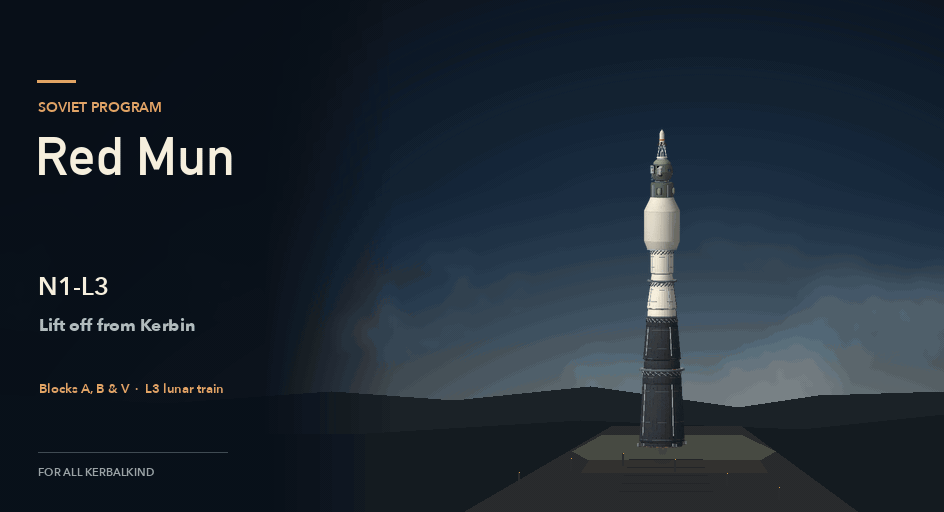
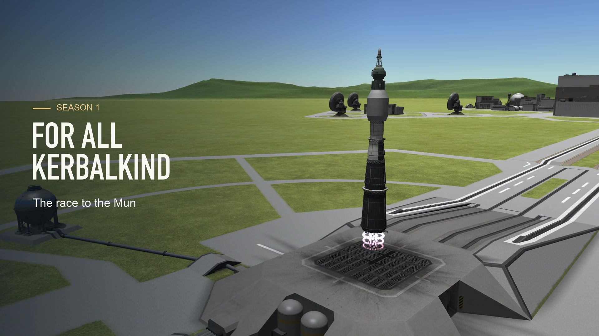
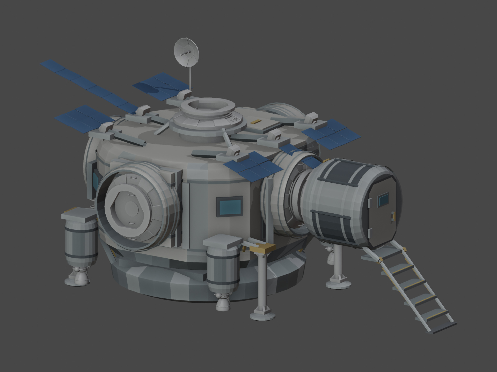

# For All Kerbalkind

For All Kerbalkind is a fan-made mod for **Kerbal Space Program 1.12.5** that lets you fly the alternate-history space race from the TV series *For All Mankind*. The show imagines that the Soviet Union lands on the Moon first and the race continues. In the game, you launch from the Kerbals’ home planet, Kerbin, and fly to its moon, the Mun.

Season 1 is playable now. Fly the Soviet N1 and its lunar lander, take Apollo 11 to the surface and bring its crew home, then deliver Jamestown and turn it into a working base. The mod adds modular rocket and spacecraft parts, ready-to-fly ships, research unlocks and missions that track what you accomplish in flight.



After installation, choose **Start Game → Scenarios → Red Mun** to begin on the launchpad with a crew and an on-screen checklist. In **Career**, research the hardware and unlock the three missions in order. In **Sandbox**, load the supplied ships or use their parts to build your own. [Fleet and hardware still](docs/season-1-fleet.png)

## From the first Mun landing to Jamestown

Watch the Soviet and American flights in KSP, from liftoff on Kerbin to a crewed outpost on the Mun.

<video controls playsinline preload="none" width="960" poster="docs/season-1-in-ksp.jpg" src="docs/season-1-in-ksp.mp4">
  <a href="docs/season-1-in-ksp.mp4"></a>
</video>

[Play the Season 1 reel (MP4)](docs/season-1-in-ksp.mp4) · [Jamestown in daylight](docs/jamestown-on-the-mun.jpg) · [Flight guide](docs/flight-guide.md)

## Install and start

1. Enable the **Breaking Ground** expansion for Jamestown's servos and hydraulic landing gear. Install ModuleManager, Contract Configurator and its Harmony dependency for Career. The release was tested with ModuleManager 4.2.3 and Contract Configurator 2.14.0. [ModuleManager](https://github.com/sarbian/ModuleManager/releases) · [Contract Configurator](https://github.com/KSP-RO/ContractConfigurator/releases) · [Harmony for KSP](https://github.com/KSPModdingLibs/HarmonyKSP/releases)
2. Download `FAMSeasons.zip` from the release you want. Unzip it into the folder that contains KSP and merge `GameData`, `Ships`, and `saves/scenarios`. The base game supplies the recovery parachutes, cabin interiors and engine effects. [GitHub Releases](https://github.com/andrei-ace/for-all-kerbalkind/releases)
3. In Sandbox, enter the VAB and select **Load**. Search for **FAM S1**. Choose **Jamestown Outpost** to inspect the landed assembly or **Jamestown Delivery** to fly its Saturn V. If a save hides stock craft, copy the six `.craft` files from `Ships/VAB` into `saves/<your save>/Ships/VAB`.
4. In Career, start with stock **Heavy Rocketry** and **Survivability**, then **Mun Launch Vehicles** and **Soviet L3 Landing System**. Upgrade the Launch Pad and Astronaut Complex to level 2. Mission Control offers **Red Mun → Apollo 11 → Jamestown Campaign** as you complete each predecessor and unlock every part on the supplied mission craft. Purchase individual parts when your difficulty settings require it. Science mode uses the same research tree.

## Season 1

| Mission | Program and hardware | Objective |
| --- | --- | --- |
| 1. Red Mun | Soviet N1, LOK, and LK | Launch from Kerbin, land the LK, redock in Mun orbit, and recover both crew |
| 2. Apollo 11 | American Saturn V, Columbia, and Eagle | Launch from Kerbin, land two Kerbals, and recover the three-person crew |
| 3. Jamestown Campaign | American Apollo 15, habitat, LSAM, and Osprey | Return a Shackleton core, establish and crew the base, and use the same LSAM for the rescue |

The 47 custom parts unlock across six new research nodes. Apollo 11 awards enough science for the three Jamestown nodes. Jamestown also needs a level 2 VAB for its 51-part delivery stack and level 2 R&D for rescue fuel transfer. Osprey spawns in polar Mun orbit when you accept the campaign. [Flight guide and fuel budgets](docs/flight-guide.md)

### Season 1 model review

[Season 1 spacecraft and editable models](docs/season-1-model-review.md) · [Columbia’s hatch, service separation and rendezvous](docs/season-1-model-review.md#apollo-csm-and-lunar-module)



Jamestown's four shrouded lateral Clamp-O-Trons each turn on a Breaking Ground F-12. The detachable airlock carries its own folding stairs. For a stairway EVA, lower the base, roll the airlock upright, deploy the stairs and transfer one Kerbal into its seat. Four hydraulic cylinders raise the ports from a nominal 1.85 m boarding height to a 2.60 m expansion height. [Model review, packing cutaway and flight controls](docs/season-1-model-review.md#jamestown)

## Standalone scenarios

Choose **Start Game → Scenarios** from KSP's main menu and select one of the three **FAM S1** entries. CommNet and crew experience limits are disabled in the scenarios.

| Scenario | Starting position |
| --- | --- |
| Red Mun | A complete N1-L3 on the Kerbin launchpad with two Kerbals in the LOK |
| Apollo 11 | A complete Saturn V on the Kerbin launchpad with three Kerbals in Columbia |
| Jamestown Campaign | Falcon landed in daylight near Shackleton, with Endeavour, the habitat delivery stack, the LSAM, and Osprey in Mun orbit |

The **Mission Checklist** names the craft, shows the next action, and marks it complete when the flight meets the objective. Jamestown starts aboard Falcon. Right-click the sampler on the landing deck, select **Drill a regolith core**, then choose **Keep Experiment**. The checklist follows the survey, base delivery, and rescue. Use its **Switch to** button at a safe point to fly the next craft.

The pad stacks begin at zero throttle with their engines shut down. Stage the lunar train at zero throttle to separate the craft and arm both engines. Columbia and the LOK each have a service burn stage, a service separation stage, and a dedicated two-chute stage. The survey craft, habitat, and LSAM stay in the same Jamestown flight save as the objectives advance. [Flight guide and objective criteria](docs/flight-guide.md)

KSP's **Load** button resumes an existing scenario's `persistent.sfs`. If it opens the Space Center, select your saved craft in the Tracking Station. To use a new scenario start, close KSP and move the matching progress folder out of `saves/scenarios`. Keep the adjacent `.sfs` template in place and open the entry again. Preserve the progress folder before using KSP's **Restart** button, which deletes that folder.

## Season 1 cast

The standalone scenarios include all ten principal Season 1 profiles. The crew textures use KSP's animated head meshes with original hairlines, colors, and facial details. Pilots use stock flight skills, while the ground staff use stock traits as gameplay counterparts to their roles. [Apple TV's Season 1 cast and character credits](https://www.apple.com/tv-pr/originals/for-all-mankind/cast-crew/)

| Counterpart | Kerbal | Role |
| --- | --- | --- |
| Ed Baldwin | Eddwin Kerman | Pilot, lunar commander |
| Gordo Stevens | Gordo Kerman | Pilot, Jamestown crew |
| Tracy Stevens | Tracie Kerman | Pilot, first women astronaut class |
| Karen Baldwin | Karrin Kerman | Civilian operations and crew support, Scientist slot |
| Margo Madison | Margo Kerman | Engineer, Mission Control |
| Ellen Waverly | Ellyn Kerman | Pilot, Apollo 24 survivor |
| Danielle Poole | Danni Kerman | Engineer, Jamestown crew |
| Octavio Rosales | Oktavio Kerman | Engineer, ground maintenance |
| Aleida Rosales | Alayda Kerman | Engineer, student profile |
| Molly Cobb | Mollie Kerman | Pilot, Shackleton survey |

## Later seasons

| Season | Planned setting | Ships, technology and campaign direction |
| --- | --- | --- |
| 2 | Mun and Kerbin orbit | Expanded Jamestown, Sea Dragon cargo launches, Pathfinder and orbital rendezvous |
| 3 | Kerbin orbit and Duna | Polaris, Phoenix, Sojourner and Mars-94 compete to establish a foothold at Happy Valley |
| 4 | Duna and the asteroids | Unity crew transfers, Ranger asteroid handling and the Goldilocks capture |
| 5 | Duna and Laythe | Surface hoppers and a Sojourner-T expedition to the stock analogue of Titan |

The later seasons are a roadmap. Season 1 ships in this release.

## Build from the source checkout

The game payload lives in `GameData/FAMSeasons`, `Ships/VAB`, and `saves/scenarios`. The editable flight assemblies and exported meshes are under `art/season-1/modular/`. The generators in `tools/` define the individual parts, craft, research and missions. Use Python 3.10 or newer and a KSP installation with Breaking Ground. [Editable flight assemblies](art/season-1/modular/)

```sh
python3 tools/verify.py --ksp-root "/path/to/Kerbal Space Program"
python3 tools/build.py --package-only --ksp-root "/path/to/Kerbal Space Program"
```

The second command verifies the extracted archive and writes `dist/FAMSeasons.zip`. The GitHub release tag identifies the version. To regenerate configs, ships, contracts and scenario starts, run the build without `--package-only`. The Blender workflow uses the KSP add-on to inspect the exported meshes with actual stock and DLC fittings. [Blender KSP add-on revision](https://github.com/taniwha/io_object_mu/tree/ff04234928b2e66f92d2d1325225e9a29f0b415c)

```sh
python3 tools/build.py --ksp-root "/path/to/Kerbal Space Program"
FAM_KSP_ROOT="/path/to/isolated KSP" ./dist/"For All Kerbalkind.command" --install-only
```

On macOS, the launcher installs the archive into the specified game. To open the launcher from Finder, save the absolute path to your isolated KSP folder on one line in `dist/.ksp-root`.

The .NET SDK and a game installation containing the dependencies also support rebuilding the habitat parameter and testing the release with KSP's configuration reader. On macOS the test uses the game's bundled Mono runtime and Command Line Tools. On Linux install Mono for the test runner.

```sh
python3 tools/build_plugin.py --ksp-root "/path/to/Kerbal Space Program"
python3 tools/stock_smoke.py --ksp-root "/path/to/Kerbal Space Program"
python3 tools/test_campaign.py --ksp-root "/path/to/Kerbal Space Program" --output "/path/to/new/test"
python3 tools/test_saturn_ascent.py --ksp-root "/path/to/Kerbal Space Program" --output "/path/to/new/ascent-test"
```

The release checks apply the research patch to the 63-node stock tree and validate the packaged configs, crew, attachment poses, staging and fuel. The desktop campaign test opens all three menu entries, launches both pad stacks, discards and keeps Falcon's sample, resumes its checklist, and checks mission eligibility in a new Career. The launcher in `dist` syncs the verified archive before starting the isolated game.

### Record the in-game reel

Run with the .NET SDK and ffmpeg installed. The tool builds a capture plug-in, stages the shots in a disposable copy of the modded KSP installation, then writes a reel and individual stills to the output folder.

```sh
python3 tools/render_scenarios.py --list-shots
python3 tools/render_scenarios.py --ksp-root "/path/to/Kerbal Space Program" --output "/path/to/new capture folder"
```

Use `--shot <name>` to select an individual scene. The output folder holds the raw frames, `stills/`, and `season-1-in-ksp.mp4`.

## Credits

- The campaign is inspired by *For All Mankind*, created by Ronald D. Moore, Ben Nedivi, and Matt Wolpert and produced by Sony Pictures Television for Apple TV+. [Apple's series credits](https://www.apple.com/tv-pr/news/2022/03/apples-coda-ted-lasso-for-all-mankind-and-carpool-karaoke-the-series-honored-at-2022-producers-guild-awards-and-more/)
- Jamestown's exterior proportions and landing arrangement draw on Daniel Jennings's set designs and *For All Mankind* screen imagery collected by Human Mars. [Jennings's Jamestown drawings](https://drjennings7.artstation.com/projects/obQ4GJ) · [Human Mars Season 1 exterior references](https://www.humanmars.net/2021/03/jamestown-us-moon-base-in-season-1-of.html)
- Futurographer's Project Grey fan art inspired the modular airlock's roof-stowed launch arrangement. [Project Grey launch study](https://www.reddit.com/r/ForAllMankindTV/comments/1spgs78/launch_of_jamestown_and_the_missions_before_it/)
- The Season 4 roadmap references the show's Art Directors Guild submission, which credits Seth Reed for production design, Ellen King for supervising art direction, and Kimberly Wannop for set decoration. [Season 4 design submission](https://assets.adg.org/media/submissions/2023-10-30_21-10-15/FAM_ADG_14mb.pdf)
- The Saturn V and Apollo parts depict hardware from NASA's Apollo program. The N1-L3 parts depict the Soviet lunar program chronicled by engineer Boris Chertok. [NASA's Apollo program history](https://www.nasa.gov/the-apollo-program/) · [Chertok's *Rockets and People, Volume IV*](https://www.nasa.gov/wp-content/uploads/2023/04/sp-4110-vol4.pdf)
- The exterior meshes and livery were made for this fan mod. The craft and captures reference stock assets from Squad's *Kerbal Space Program*. The part files credit NovaSilisko for the Mk2-R parachute, OX-STAT, ladder, girders, and Z-100 battery, Squad for the Communotron 16-S and rover wheels, AlexanderM for the Clamp-O-Tron and Probodobodyne QBE, and Porkjet for the Mk1 Crew Cabin. The game also supplies the cockpit interiors, engine effects, and fairing textures. [Kerbal Space Program credits on Steam](https://store.steampowered.com/app/220200/Kerbal_Space_Program/)
- Jamestown uses the stock 48-7S Spark, the Breaking Ground F-12 servo and 1P2 cylinder by RoverDude, and the stock Clamp-O-Tron by AlexanderM. The airlock, stair flight, shrouds, descent tanks, frame and footpads are original mod meshes. The editable assemblies store stock and DLC attachment references. [Kerbal Space Program credits on Steam](https://store.steampowered.com/app/220200/Kerbal_Space_Program/)
- The Blender workflow uses Bill Currie's `io_object_mu` add-on. The source checkout includes its standalone `mu.py` codec under GPL-2.0-or-later, with the license and upstream notice in `tools/vendor/`. [Pinned add-on revision](https://github.com/taniwha/io_object_mu/tree/ff04234928b2e66f92d2d1325225e9a29f0b415c)
- ModuleManager was created by Ialdabaoth and is maintained by sarbian and contributors. Contract Configurator was created by Jeremie Rossignol (nightingale) and is maintained by KSP-RO and contributors. Harmony for KSP is distributed by KSP Modding Libraries and uses Andreas Pardeike's Harmony library. [ModuleManager](https://github.com/sarbian/ModuleManager) · [Contract Configurator](https://github.com/KSP-RO/ContractConfigurator) · [Harmony for KSP](https://github.com/KSPModdingLibs/HarmonyKSP) · [Harmony](https://github.com/pardeike/Harmony)
