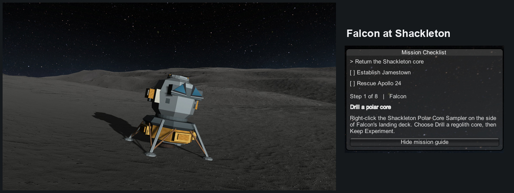
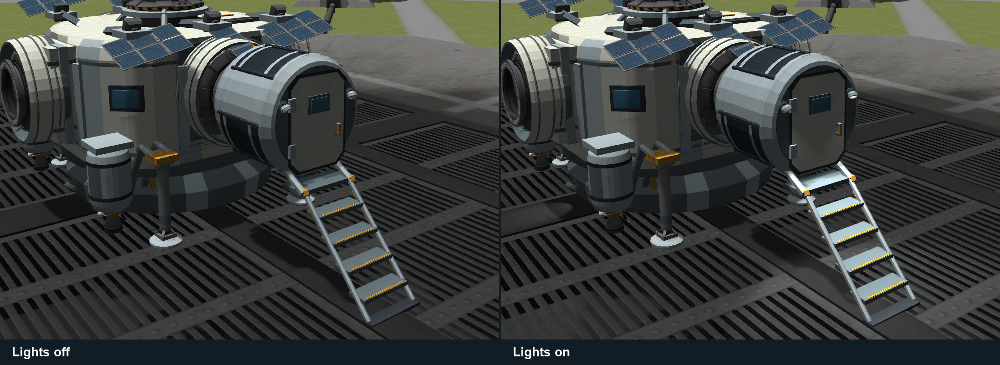
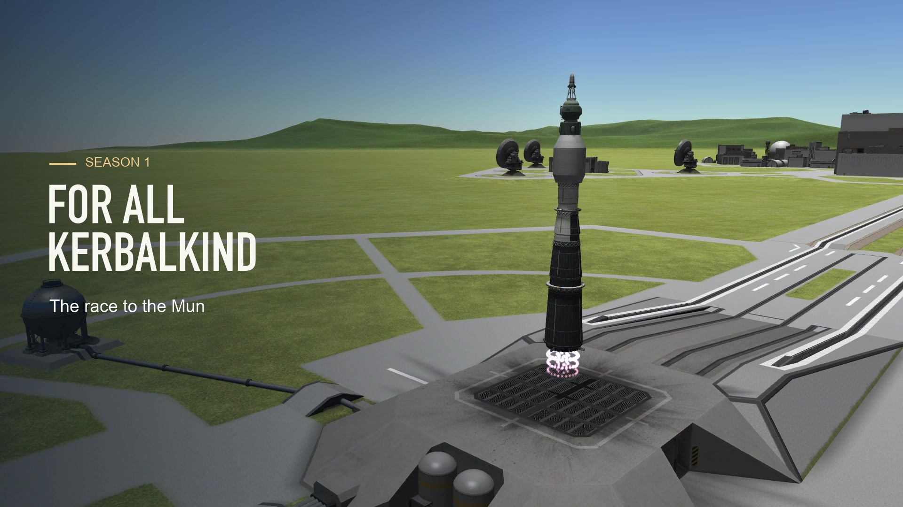

# Season 1 flight guide

Season 1 follows three missions around stock Kerbin and the Mun. Career starts with the Soviet Red Mun flight, followed by the American Apollo 11 and Jamestown flights. The Scenarios menu lets you start any of the three directly.

## Research and facilities

| Research | Science | Opens |
| --- | ---: | --- |
| Mun Launch Vehicles | 45 | N1 and Saturn V stages, adapters, separators and escape tower |
| Soviet L3 Landing System | 45 | LOK, LK and Block G, Red Mun contract |
| Apollo Lunar Systems | 45 | Apollo CSM and two-stage LM |
| Polar Prospecting | 60 | Shackleton core sampler, after Apollo Lunar Systems |
| Surface Habitation | 90 | Jamestown and its landing platform |
| Reusable Mun Logistics | 90 | LSAM flight deck, propulsion deck and rescue tank |

Start with stock Heavy Rocketry and Survivability, a level 2 Launch Pad and a level 2 Astronaut Complex for EVA. Mission Control checks that all mod, stock and expansion parts on the mission's supplied craft are unlocked, including individual purchases when enabled. Complete Red Mun to qualify for Apollo 11, then complete Apollo 11 to qualify for Jamestown. Apollo 11 awards 240 science for the three Jamestown technologies. Jamestown also requires a level 2 VAB for its 51-part delivery vehicle, level 2 R&D for propellant transfer and Breaking Ground for its landing and docking hardware.

## Staging

These numbers refer to the supplied VAB stacks. Docking and vessel separation can renumber stages, so confirm the parts highlighted by the next stage in flight.

| Stage | N1-L3 | Saturn V Apollo | Jamestown and LSAM delivery |
| --- | --- | --- | --- |
| 7 | Block A lifts off | — | — |
| 6 | Release Block A and the escape tower, start Block B | S-IC lifts off | S-IC lifts off |
| 5 | Release Block B, start Block V | Release S-IC and the escape tower, start S-II | Release S-IC, start S-II |
| 4 | Release Block V, start Block G | Release S-II, start S-IVB | Release S-II, start S-IVB |
| 3 | At zero throttle, release the fairing and transfer stage, separate the LOK and LK, and arm both engines | At zero throttle, release the fairing and S-IVB, separate the CSM and LM, and arm both engines | At zero throttle, release the fairing and S-IVB and arm the landing engines |
| 2 | Leave the LK landing frame behind and arm the ascent engine | Leave the LM descent stage behind and arm the ascent engine | — |
| 1 | Separate the LOK service section | Separate the Apollo Service Module | — |
| 0 | Two radial parachutes | Two radial parachutes | — |

The escape tower's main motor fires through **Abort**. Routine staging discards the tower with its separator. Cut throttle before releasing a landing platform, wait until it is clear, then throttle up for ascent. The LOK and Apollo service engines arm at payload release and contribute to delta-v before service separation. Their automatic shrouds follow the bottom attachment. The final recovery stage contains the two chutes.

The table uses the VAB stage numbers. KSP removes empty stages as hardware drops away. In the tested Jamestown parking orbit, the cargo release originally numbered **3** appeared as **0**. Look for the fairing and four Spark icons together. Keep the throttle closed for release, then throttle up once the carrier is clear.

## 1. Red Mun

Load **FAM S1 - N1-L3**. Put both Kerbals in the LOK and leave the LK empty. Lift off on Block A at stage 7. Stages 6 and 5 start Blocks B and V. The escape tower leaves with the first staging event after liftoff. Stage 4 starts Block G for the transfer and insertion. A low Mun parking orbit leaves a short return climb for the LK.

Cut throttle before stage 3. It releases the LOK and LK from the spent transfer stage and arms their engines at zero throttle. Turn the LOK, select its nose port as the control point, and dock nose-to-nose with the LK. Transfer one Kerbal, undock, and briefly control the LOK until the orbit objective checks off. Keep the other Kerbal in orbit.

Land the LK on its four-foot platform. Once touchdown registers, zero the throttle and stage away the platform. The orange total below staging shows the LK's remaining ascent delta-v. Throttle up after clearing the platform. Rendezvous with the LOK and move the pilot back to the return cabin. Undock and leave the LK in Mun orbit before the return burn. Follow the Kerbin recovery procedure below.

## 2. Apollo 11

Load **FAM S1 - Saturn V Apollo** with three Kerbals in the command module. Stages 6, 5 and 4 start the S-IC, S-II and S-IVB. Use the restartable S-IVB for transfer and insertion. At zero throttle, stage 3 exposes the LM, releases the two spacecraft, and arms their engines. Turn the command ship and dock with the LM. Transfer two Kerbals, undock and control the lone command pilot until the orbit objective registers.

Land the LM, cut throttle and leave the descent stage on the surface at stage 2. Dock the ascent cabin to the waiting command ship and transfer both crew back. Undock the LM and use the service engine for the return. Follow the Kerbin recovery procedure below.

## 3. Jamestown Campaign

Start aboard **Falcon**, already landed on a sunlit shelf near Shackleton. Right-click the **Shackleton Polar Core Sampler** on the side of the landing deck, choose **Drill a regolith core**, then choose **Keep Experiment**. The checklist advances to the EVA and ascent instructions.

Return the sample aboard **Endeavour**. Next, fly the uncrewed **Jamestown** habitat down from Mun orbit. Land the **LSAM** beside it, board the habitat on EVA, then launch that same LSAM to rescue Ellyn. The checklist names the current craft and offers **Switch to** at a safe point. Jamestown and the ferry keep their positions, crew, and supplies between objectives.

### Into the Crater

In Career, load **FAM S1 - Apollo 15 Survey**. Its Shackleton Polar Core Sampler is fitted to the LM landing deck. The campaign contract marks **77° S, 12° E**. An inclined or polar approach saves a large plane change near the Mun. In the scenario, Falcon already sits near the site.

Land within 1.2 km of the marker with a Kerbal aboard. Open the sampler, select **Drill a regolith core** and keep the result. On EVA use **Take the core**, then board the ascent cabin. After rendezvous, move the experiment into the return cabin using an EVA Kerbal and its **Store samples** action. Check **Review samples** before discarding the lander. Recover the experiment on Kerbin to finish the contract.

### Base delivery

Load **FAM S1 - Jamestown Delivery** and leave both the habitat and airlock empty. The habitat has its own probe core. In Career, plan CommNet coverage or provide a relay. After Saturn stage 4 has established Mun orbit, cut throttle and use stage 3 to release the fairing and delivery stage and arm the four stock Sparks. Each is limited to 35% thrust.

Start turning east on the first stage. As the S-IC burns out, keep the nose near the **surface prograde** marker through separation. The tail fins leave with the booster. The S-II steers with its engine cluster. On the tested ascent the handoff came at 23.9 km and 725 m/s, and the second stage settled within 0.5° of the commanded heading seven seconds later. Continue pitching toward the horizon as the air thins.

Circularize at about 80 km over Kerbin before starting the transfer. During transfer, adjust the Mun encounter so the incoming path passes over a pole and the projected ground track crosses Shackleton at **77° S**. Capture retrograde near **34 km** and wait for a pass over the site. A late 90° plane change in that circular orbit costs about **746 m/s**. Use terrain altitude for final braking. Falcon's landing shelf is about **6 km above the Mun's datum**.

After the delivery-stage release, right-click the habitat and choose **Release roof airlock**. You can also select **Decouple** on the TS-12 between the roof and the airlock. Wait until the ring has drifted sideways past the roof port and both collars read **Ready**. This took 8–11 seconds at normal physics speed in the tested flights. Switch to the airlock, choose **Control From Here** on its Clamp-O-Tron, target the front port and translate with RCS. The airlock carries its own probe, power and monopropellant. The standalone scenario starts with the airlock already on the side. Before descent, choose **Control From Here** on the habitat’s fixed roof port and keep the stairs stowed.

If an older save was made **after** the separator fired and the ships stuck together, reload that save. On the airlock’s stock Clamp-O-Tron choose **Undock**. Switch to the airlock, select **Control From Here** on its collar and translate backward with RCS until both ports read **Ready**. You can then approach a side port normally.

Choose level terrain within 1.2 km of the site with room to approach the ports. Set all four footpads down within 15° of vertical with at least 100 ElectricCharge. Hold surface speed below 0.5 m/s for 30 seconds. The roof arrays and switchable fuel cell supply power.

### Jamestown expansion ports

Stow the stairs and turn **Gear** on (default **G**) to extend all four cylinders. Once the feet settle, choose **Lock landing cylinders** on the frame. Turn Gear off to lower the outpost for boarding. The frame also has direct **Raise to expansion height** and **Lower to boarding height** controls. Fit a standard **Clamp-O-Tron Docking Port** to the visiting module, choose **Control From Here** on that port, match its loaded height to the base and approach face-to-face. On the habitat, **Dock rotation** opens each station’s F-12 controls. The ports accept any roll angle.

| Interface | Season 1 dimensions |
| --- | --- |
| Ground datum | Bottom face of the four footpads attached to the 1P2 cylinders |
| Horizontal dock axes | West and east face along local ±X, front and rear along ±Z |
| West/east docking faces | Local X ±2.38 m, Y −0.15 m, Z 0 m on the habitat |
| Nominal centerline height | 1.85 m for boarding or 2.60 m at full lift. Match the actual height under load |
| Docking type | Stock 1.25 m `size1`, genderless |
| Approach room | Keep a 1.0 m radius clear along each axis from the docking face outward |

Four annular shrouds surround the lateral bearings and leave the docking faces clear. A fifth fixed port sits on the roof. The detached airlock has its own sixth Clamp-O-Tron. [Jamestown assembly and expansion interfaces](season-1-model-review.md#jamestown)

### First crew

In Career, load **FAM S1 - LSAM Delivery** with at least two Kerbals. Use the Saturn upper stage to settle into a low polar orbit around **20–25 km** before releasing the ferry. In the scenario, switch to the LSAM already in orbit. Land within **200 m of Jamestown** with at least **180 LiquidFuel and 220 Oxidizer**. Burn retrograde close to the site and keep hovering brief to preserve the rescue reserve.

Wait for the parking objective. Lower and lock the frame. With the stairs folded, roll the docked airlock until its blue window is up and its stair hinge is down. Lock the servo and choose **Deploy Stairs** on the airlock. **Lights** (default **U**) switches on the frame’s landing lights and the airlock’s boarding lights. Once detached, each vessel controls and powers its own fixtures.

Walk up, board at the hatch, then **Transfer Crew** from the one-seat airlock into the habitat so the checklist registers the resident. In the scenario send Danni inside and keep Tracie aboard the LSAM for the rescue.

To leave down the stairs later, transfer a Kerbal from the hull into the docked airlock, then choose **EVA** on that Kerbal's portrait. The hull also has a separate exit.

### Apollo 24 rescue

**Apollo 24 Osprey** waits with a survivor and empty service tanks in a 48 × 142 km polar Mun orbit. Resume the LSAM beside the habitat after the first crew objective.

1. Target Osprey and launch the LSAM as its orbital plane crosses the base. Match planes and phase the rendezvous. Close within 150 m, then dock the two nose ports.
2. Transfer the named survivor into an empty LSAM seat. Move at least **18 LiquidFuel and 22 Oxidizer** into Osprey's **service-module fuel bay** using the stock resource transfer controls.
3. Undock to let the checklist verify both craft independently. In Career, switch to **Osprey** for its fuel check before returning to the ferry.
4. In the scenario, park the LSAM within **200 m** of Jamestown with the survivor aboard. In Career, land within **1.2 km** of the survey marker. Bring the survivor up the stairs, board the airlock and transfer her into the habitat. In Career, focus the habitat to finish the contract.

## Kerbin recovery

1. Transfer the crew and any core sample into the return cabin. Undock the lander while you are still in Mun orbit.
2. Use the service engine for the return burn. Check in map view that the Kerbin approach has a periapsis near **36 km**. Take a quicksave while the vessel is still outside the atmosphere.
3. Zero the throttle and release the ring under the return cabin before atmospheric entry at **70 km**. If docking changed the staging order, right-click the ring to decouple it. The returning vessel should be the capsule and its two side-mounted parachutes.
4. Switch the navball to **Surface** speed and turn the capsule retrograde, with its broad heat shield facing into the airflow. Use the pilot's retrograde hold if available. The LOK carries **250 units of Ablator** and the Apollo Command Module carries **410**.
5. When the parachute indicators show safe deployment, stage **both** chutes. They fully open near 1 km above ground once armed and within their pressure and speed limits. After landing or splashdown, choose **Recover Vessel**.

## Scenario objectives

The in-flight **Mission Checklist** highlights the next objective and marks it complete from the actual state of the flight. Use **F5** to save and **hold F9** to restore the flight and its checkmarks. The Scenarios menu resumes an existing scenario save. Archive its progress folder before starting over.

| Scenario | What the checklist verifies |
| --- | --- |
| Red Mun | Launch N1 from the pad, crew the LK in Mun orbit, land and redock, then bring both Kerbals home. |
| Apollo 11 | Launch Saturn V, crew Eagle in Mun orbit, land and redock, then bring all three crew home. |
| Jamestown Campaign | Bring back Falcon's core, land the habitat upright and powered within 1.2 km of the site, and park the two-seat crew beside it with rescue fuel. Fly the same LSAM to Osprey, refuel its service module, and bring Ellyn into Jamestown. |

The Kerbin objectives finish at safe touchdown or splashdown with the crew and any required sample in the return cabin. Use **Recover Vessel** to close out the flight.

## Season 1 flight reel

Follow the N1 and Saturn V from Kerbin’s launchpad to the Mun. The Jamestown sequence shows the carrier release, the airlock separating from its roof mount, and the outpost’s boarding lights at Shackleton.

[Watch the flight reel on YouTube](https://www.youtube.com/watch?v=cf8Nhy6frKE) · [View the poster](season-1-in-ksp.jpg) · [Columbia and Eagle close-ups](season-1-model-review.md#apollo-csm-and-lunar-module)

## Fuel margins

The launcher column uses sea-level first-stage performance and vacuum performance above it, with the shipped crew, fairings and propellant loads. Jamestown launches with 38 t of S-IC propellant and a full S-IVB. The Apollo and LSAM boosters carry 34 t. LSAM flies with its S-IVB at 60%.

| Flight | Launcher through transfer | Descent budget | Ascent or return budget |
| --- | ---: | ---: | ---: |
| Red Mun | 5,559 m/s | 1,177 m/s in LK | 1,116 m/s in LK ascent and 1,121 m/s in LOK |
| Apollo 11 | 5,436 m/s | 1,162 m/s in LM | 1,121 m/s in LM ascent and 1,059 m/s in CSM |
| Apollo 15 survey | 5,425 m/s | Same LM with the core sampler on the descent frame | Same ascent and return stages as Apollo 11 |
| Jamestown delivery | 5,712 m/s | 974 m/s on the four Sparks | — |
| LSAM delivery and rescue | 5,649 m/s | 796 m/s before the parking reserve | 1,801 m/s at the required parking reserve |

The fully fueled LSAM has 2,598 m/s after reserving the propellant donation. Descent, ascent and return use vacuum performance. Actual fuel remaining depends on the trajectory, payload and crew aboard when you stage.

### Jamestown polar delivery

The stock community map budgets **3,400 m/s** to an 80 km Kerbin orbit, **860 m/s** to intercept the Mun, **280 m/s** to capture, and **580 m/s** to land from a 14 km Mun orbit. That is **4,540 m/s** to low Mun orbit and **5,120 m/s** to the surface. On the map's all-vacuum basis Jamestown's launcher carries **5,867 m/s** through delivery, with another **974 m/s** aboard the outpost. Actual ascent consumption varies with the flight profile. [Community Delta-V Map by Kowgan, swashlebucky and contributors](https://forum.kerbalspaceprogram.com/topic/87463-173-community-delta-v-map-27/)

| Phase | Available with the supplied payload | Flight allowance |
| --- | ---: | --- |
| Kerbin ascent, S-IC and S-II | About 3,947 m/s in vacuum | Allow 3,400–3,800 m/s to reach parking orbit, leaving about 147 m/s at the high end |
| Transfer and polar capture, S-IVB | 1,920 m/s with the packed outpost | 860 m/s for transfer and up to 310 m/s for capture. Even if circularization and targeting use 400 m/s, about 350 m/s remains |
| Landing, detached Jamestown | 974 m/s in vacuum | Allow 600–870 m/s for the descent. At the high end about 104 m/s remains for settling or a short divert |

In KSP the delivery stack reached a **76.0 × 87.7 km** parking orbit on the first two stages. Peak dynamic pressure was 15.8 kPa. The S-II still held 0.447 t of propellant at separation, the S-IVB had its full 1,920 m/s, and the four landing tanks retained their 1.76 t launch load. From that parking orbit the 860 m/s transfer and 310 m/s capture allowances leave **750 m/s** for targeting and other corrections. A separate release check from the saved orbit confirmed that one staging command cleared the fairing and S-IVB and armed all four Sparks.

The upper-stage figures include the packed outpost. Its four separate descent tanks carry 1.76 t of propellant through delivery. In the campaign's circular **34 km**, **90°** Mun orbit, the uncrewed outpost has **2.61 Mun TWR** with the Sparks limited to 35%. A finite-thrust calculation using the scenario save and Falcon's 6.04 km shelf used **726 m/s** and left **248 m/s**. It assumes an aligned ground track, starts powered braking 6 km above the shelf and targets a 1 m/s touchdown. In KSP, the same 37-part outpost landed 450 m from the Shackleton marker with 228 m/s left. After 30 seconds on its feet it was tilted 2.4° and moving at 0.002 m/s.

An ideal transfer from an 80 km circular Kerbin orbit to the Mun’s orbital radius costs 856 m/s and arrives with 365 m/s of excess speed relative to the Mun. At a 34 km Mun periapsis that gives a 303 m/s circularization burn.

Jamestown stays on the surface. The LSAM handles later ascents, and the crewed return ships carry their own service fuel for the roughly 250–310 m/s burn back toward Kerbin.
