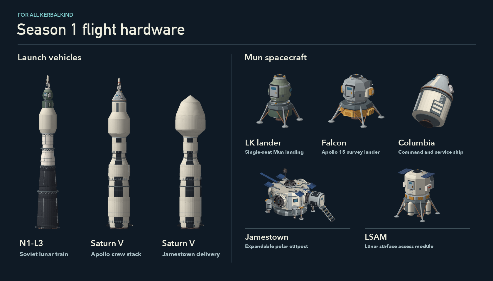
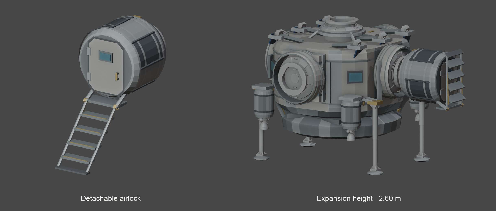
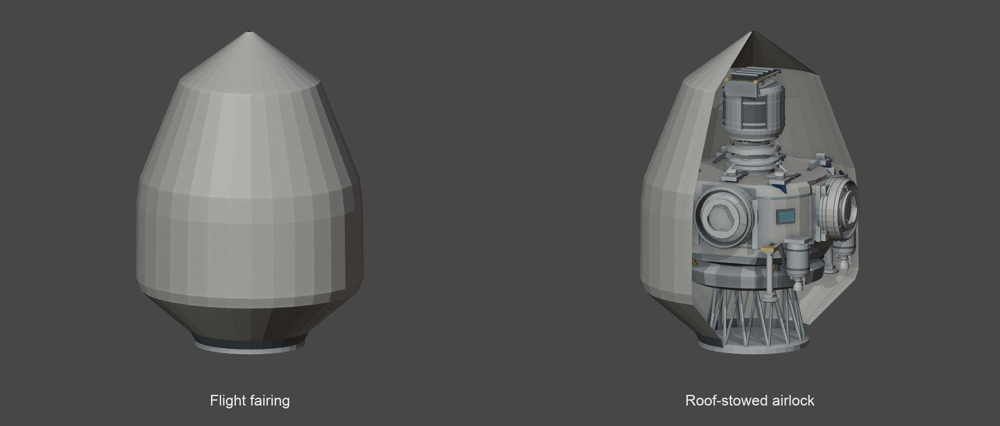
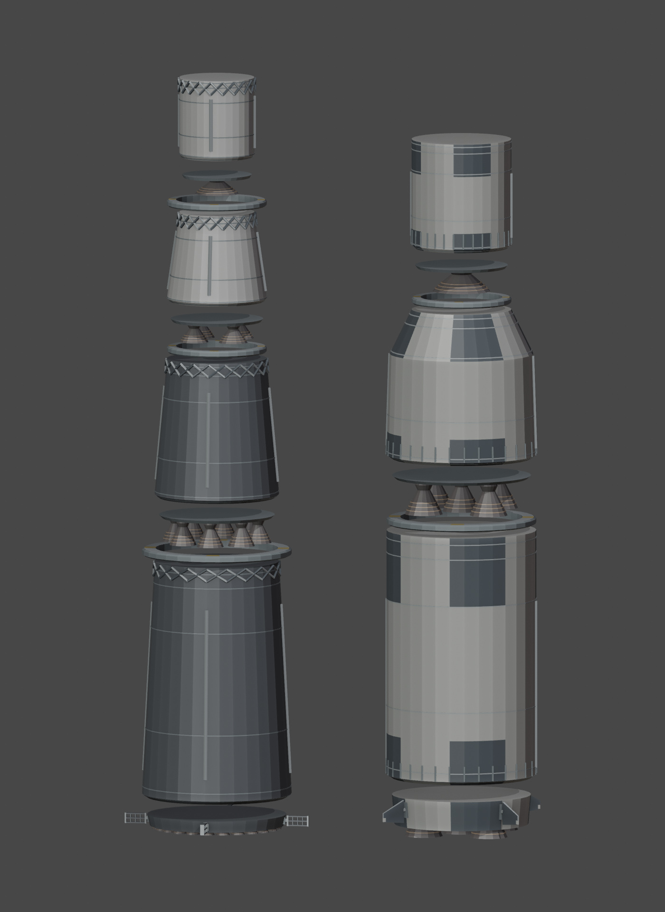
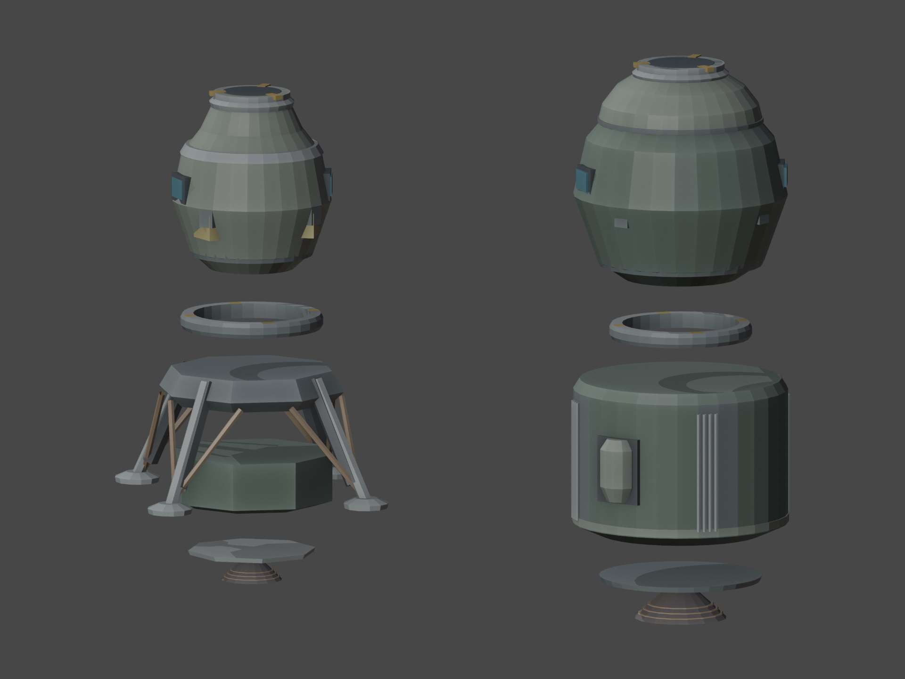
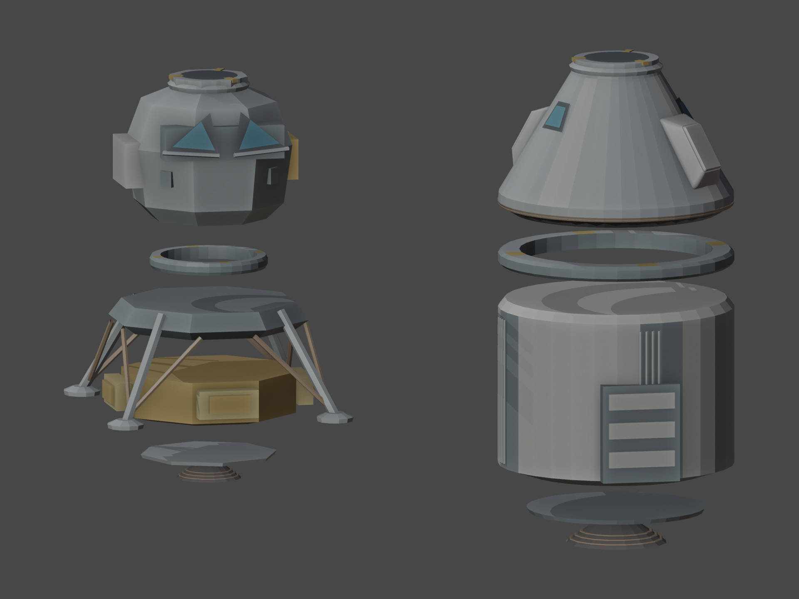
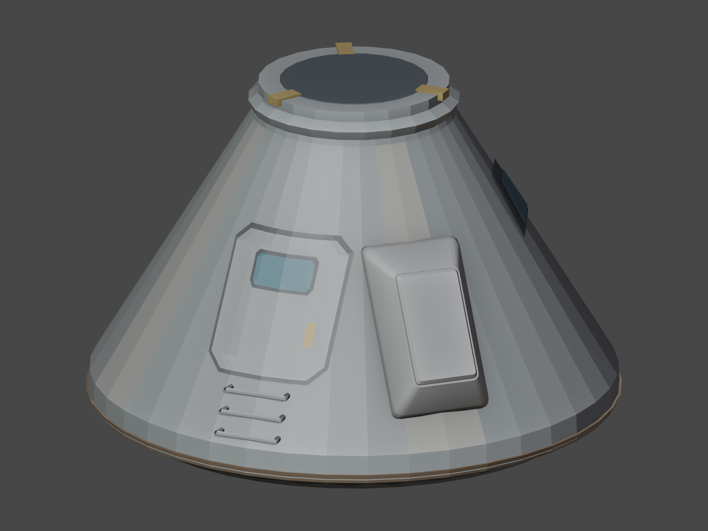
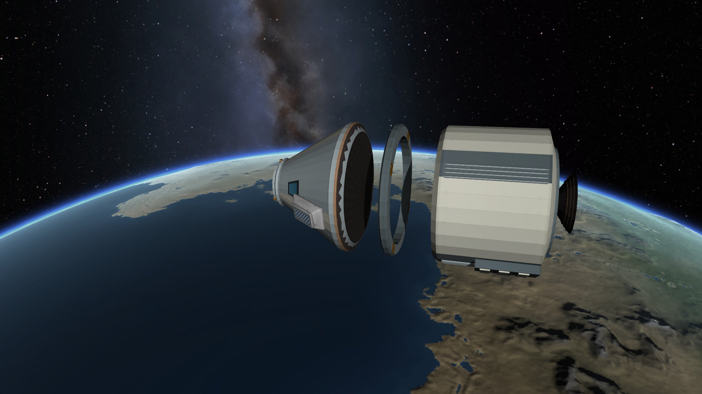
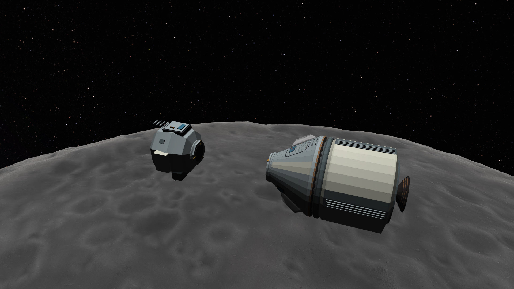
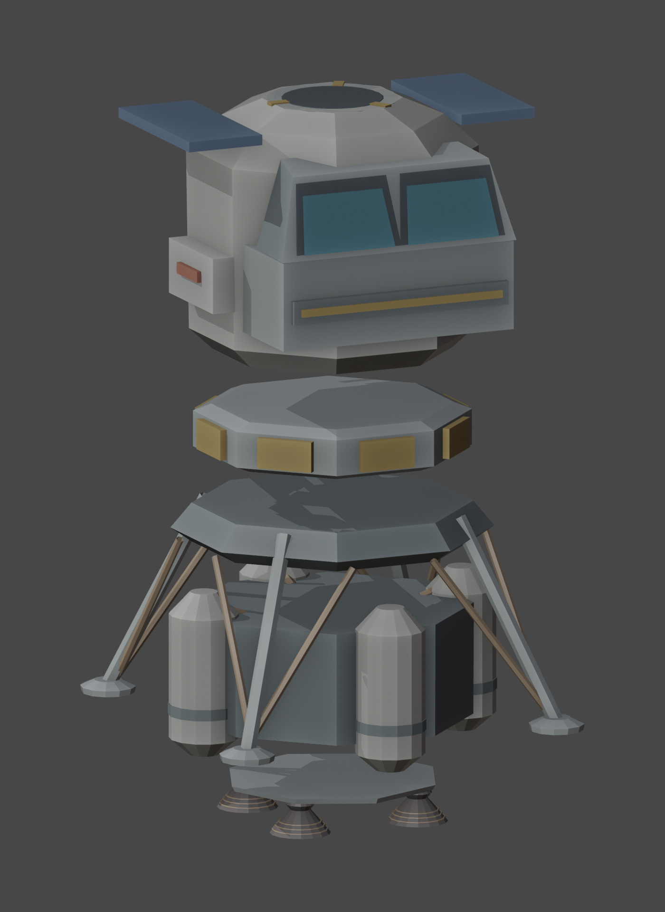

# Season 1 model review

These are the modular ships supplied in Season 1. Each assembly has separate editable parts at its flight attachment planes. The Jamestown views use the meshes and joint axes from KSP 1.12.5 and its Breaking Ground expansion.



[Watch the flights in KSP (MP4)](season-1-in-ksp.mp4) · [In-game poster](season-1-in-ksp.jpg) · [Animated mission intro](season-1-scenarios.gif)

## Review in KSP Sandbox

Open **For All Kerbalkind** and enter Sandbox. In the VAB, choose **Load** and search for **FAM S1**. The isolated game uses the same six craft and 47 custom parts as Career and the campaign scenarios. The two Jamestown craft also use installed Breaking Ground parts.

| VAB craft | Inspect |
| --- | --- |
| FAM S1 - Jamestown Outpost | The assembled outpost with side airlock, deployed stairs and four turnable lateral stations |
| FAM S1 - Jamestown Delivery | The folded habitat and roof-stowed airlock inside the Saturn V fairing |
| FAM S1 - N1-L3 | The N1 clusters, LOK and LK in one launch stack |
| FAM S1 - Saturn V Apollo | Saturn V, Columbia and the two-stage Eagle lunar module |
| FAM S1 - Apollo 15 Survey | Apollo survey stack with Falcon's Shackleton core sampler fitted |
| FAM S1 - LSAM Delivery | The reusable ferry, rescue reserve and Saturn V launcher |

Use **Jamestown Outpost** for an unobstructed view of the replaceable tanks and engines. Each Spark has its thrust limiter set to 35%.

## Jamestown

The Phase 1 floor plan gives Jamestown a circular pressure room, four straight-sided alcoves, and a detachable cylindrical airlock at the front. The blue windows sit between the facets. Six stock arrays spread over the roof. A stock HG-5 relay and Pegasus I ladder sit beside the spare cabin hatch. The docking collars, descent motors, and hydraulic legs are independently replaceable in the VAB. [Assembled outpost](models/jamestown-assembled.jpg) · [Daylight view in KSP](jamestown-on-the-mun.jpg) · [Editable assembly](../art/season-1/modular/jamestown.blend)

| Part | Role |
| --- | --- |
| Habitat | Four crew seats, probe control, power, service and roof hatches, four lateral port mounts and a fixed roof port mount |
| Dockable airlock | One seat, probe core, 75 EC, reaction wheel, 12 units of monopropellant, four RCS clusters, hatch sill and folding stairs |
| Six stock Clamp-O-Trons | One per lateral cabin face, one on the roof and one on the airlock |
| Four Breaking Ground F-12 rotation servos | One per lateral station, turning the stock Clamp-O-Tron and its docked module around the tunnel axis. Original hollow shrouds cover the bearings and port barrels |
| Landing frame | Four braced cylinder seats, four descent-tank sockets and a central delivery mount |
| Four Breaking Ground 1P2 hydraulic cylinders | Each moving piston carries an individual Jamestown footpad |
| Four Jamestown descent tanks and stock Sparks | One tank per engine at 88% fill. Four 35% thrust limiters give 28 kN in vacuum |

### Boarding and expansion



The hinge, four tread colliders, threshold and ground shoe travel with the airlock. At boarding height the flight folds down 137° from the outer hatch. The first tread from the ground is 0.229 m high. The rubber shoe ends 2 mm above the unloaded foot plane, and all four bare Spark bells clear that plane by 0.210 m.

| Level-ground setting | Piston stroke | Lateral port centre | Stair position |
| --- | ---: | ---: | --- |
| Boarding | 0.00 m | 1.85 m | Deployed for EVA |
| Expansion | 0.75 m | 2.60 m | Stowed during height changes and docking |

1. On landing, select **Lower to boarding height** on the structural frame. It commands the four attached 1P2 cylinders together. Let them settle and select **Lock landing cylinders**. Each cylinder also has its stock controls for individual trim.
2. With the stairs stowed, right-click the habitat, open **Dock rotation** and select the servo for the occupied station. Unlock its **F-12** and adjust **Target Angle** until the airlock's blue window is up and the hinge is down. The supplied outpost starts upright at **0°**. Lock the servo, then choose **Deploy Stairs** on the airlock. Each station has direct controls and works without a KAL-1000.
3. For expansion, stow the steps and select **Raise to expansion height** on the frame. Lock the four legs after they reach their commanded positions. Bring the visiting module up to a free end port. Lower again for boarding after the joined bases have compatible ground support.

For a stairway EVA, use **Transfer Crew** to put one Kerbal into the docked airlock, then select **EVA** on that crew portrait. On return, board at the outer hatch and transfer the Kerbal back into the habitat. The campaign checks the habitat seats for residents and the rescued crew member. The hull has its own independent exit.

The east and west docking faces are at **X ±2.38 m, Y −0.15 m, Z 0 m** in habitat-local KSP axes. Fit a standard 1.25 m Clamp-O-Tron of docking type `size1` on the visitor and keep a **1.0 m radius** clear along the approach axis. Use the common 2.60 m expansion datum for future modules. A module designed for the lower setting can dock at 1.85 m. Match the actual heights under load.

KSP measured the 37-part uncrewed outpost at **6.594 t** with **1.76 t** of descent propellant. At this fill the four Sparks yield **974 m/s** of calculated vacuum delta-v and **2.61 Mun TWR**. The estimate includes powered robotics and KSP's mass adjustment for empty seats.

On the level Kerbin launchpad the port measured **1.82 m** for boarding and **2.58 m** when raised. Each cylinder travelled **0.747–0.749 m**, locked, and lowered again. KSP rotated all four stations independently, rolled the attached airlock through 60° and back, and registered all four stair treads. A Kerbal exited and reboarded through both the habitat and detachable airlock. A separate stock Clamp-O-Tron docked to the raised east station after the fixture aligned it for final approach.

### Packing and orbital assembly



The stowed airlock rides on a stock TS-12 above the roof port. The jacks retract, the stairs fold against the hatch, and the panels and relay fold inward. The 32-sided fairing reaches **5.16 m** across the landing gear. Its upper panels taper to a **3.20 m** shoulder around the roof airlock, then close with a **1.14 m** conical cap. The last panel ring is **7.10 m** above the fairing pivot. Blender measured **58 mm** of minimum clearance around the packed hardware. [Editable packed assembly](../art/season-1/modular/jamestown-packed.blend)

After fairing and payload release, decouple the roof TS-12. Switch to the powered airlock, use **Control from Here** on its Clamp-O-Tron and target the front collar. Translate with RCS. Use the gold marks for an initial upright roll. The stock ports accept a visitor at any roll angle. The F-12 can then align the stairs with the ground. Use the habitat roof port as the control point for descent.

## Launch vehicles



The N1 uses separate tank bodies and engine clusters for Blocks A, B, V, and G. The supplied launch-pad photo guides the livery, with charcoal Blocks A and B, pale upper stages, and a dark roll marking on Block V. Block A keeps all 30 bells and uses four active grid fins. Saturn V uses the same split for the S-IC, S-II, and S-IVB, with four swept control fins on the S-IC. Upper-stage engine shrouds cover the bells on the pad and release when the stage below separates.

The launch stack uses one long tank per stage. Rigid stack attachments and grandparent autostruts brace the engines, tanks, and interstage rings across the split joints. The S-II tank braces to the root part, its 3.75 m engine plate uses size-3 stack nodes, and the five-engine cluster can gimbal through 4° in pitch and yaw. [Assembled launchers with shrouds](models/launchers-assembled.jpg) · [Both kinds of tail fins](models/launchers-tail.jpg) · [Editable launcher assemblies](../art/season-1/modular/launchers.blend)

The N1 ascent test flew through Block A separation and continued under Block B thrust. The Jamestown figures below are calculated for the hydraulic delivery configuration.

| Supplied vehicle | Liftoff mass | Liftoff TWR | Launcher delta-v |
| --- | ---: | ---: | ---: |
| N1-L3 | 60.3 t | 1.46 | 5,559 m/s |
| Saturn V Apollo | 72.9 t | 1.41 | 5,436 m/s |
| Apollo 15 Survey | 73.0 t | 1.41 | 5,425 m/s |
| Jamestown Delivery | 76.4 t | 1.34 | 5,712 m/s |
| LSAM Delivery | 68.3 t | 1.51 | 5,649 m/s |

The estimates use sea-level specific impulse for the first stage and vacuum values for the upper stages. Crew mass includes two Kerbals in the N1-L3 and three each in Apollo and LSAM.

## LOK and LK



The LOK keeps the crew shell, ablator, and nose port together. Its service bay, service engine, and return separator are separate. The LK keeps the small ascent engine with the single-seat ascent cabin. Its four-foot frame, descent tank, and braking engine use three independent parts below the ascent separator. [Editable LOK and LK assemblies](../art/season-1/modular/soviet.blend)

## Apollo CSM and lunar module



The Apollo command capsule carries the heat shield and the existing radial chute mounting surfaces. The service bay and engine attach below the service separator. The LM ascent cabin separates from the four-pad descent frame. The frame, foil-covered tank assembly, and descent engine can be selected independently. Falcon uses this LM layout with the surface sampler attached. [Editable Apollo assemblies](../art/season-1/modular/apollo.blend)



Columbia’s blue-windowed side door follows the taper of the capsule. Its gasket stands 8 mm above the skin and the gold handle stands 30 mm proud. The three footholds below the door lead to the EVA hatch. The larger rectangular case beside it is one of two stock Mk2-R parachutes, both assigned to the final recovery stage. In the KSP orbital check, Mikel Kerman exited through this hatch, received the stock boarding prompt and reboarded with both parachute packs fitted. [Editable Columbia capsule](../art/season-1/famApolloCM.blend)

| Columbia discards its service module over Kerbin | Eagle approaches Columbia in Mun orbit |
| --- | --- |
| [](models/ksp-columbia-separation.jpg) | [](models/ksp-eagle-rendezvous.jpg) |

## LSAM



The ferry has a flight deck, a separate rescue reserve, a four-leg landing frame, a tank assembly and a four-engine pack. The assembled propulsion system stays with the ferry for repeated landings and ascents. Osprey uses the Apollo command and service kit. [Editable LSAM assembly](../art/season-1/modular/lsam.blend)

## Review files

The [assembly and mesh directory](../art/season-1/modular/) contains the editable Blender layouts, original atlas and separate `.mu` meshes. The Blender files identify each attachment and the path for stock references. To render the models with the real stock hardware, use Blender with the KSP import add-on enabled.

```sh
blender --background --addons io_object_mu --python-exit-code 1 --python tools/blender_review.py -- --ksp-root "/path/to/Kerbal Space Program" --output "/path/to/model review"
python3 tools/install_local.py --ksp-root "/path/to/isolated KSP"
```

The installer syncs the isolated game from `dist/FAMSeasons.zip`. Add `--check` for a read-only comparison. The launcher in `dist` syncs before starting KSP. Pass `--install-only` to that launcher to update the game without opening it.

Jamestown's silhouette and landing arrangement use Daniel Jennings's drawings and the Season 1 frames collected by Human Mars. Futurographer's Project Grey fan art supplied the inspiration for packing the two modules one above the other. KSP's part configurations credit RoverDude for the Spark, TS-12, F-12 servo and 1P2 cylinder, AlexanderM for the Clamp-O-Tron, NovaSilisko for the OX-4W and OX-4L arrays, and Squad for the HG-5. The habitat, airlock, stairs, exposed tanks, chassis and footpads are original mod meshes. The editable files store references to stock and DLC parts. [Jamestown set drawings](https://drjennings7.artstation.com/projects/obQ4GJ) · [Season 1 exterior references](https://www.humanmars.net/2021/03/jamestown-us-moon-base-in-season-1-of.html) · [Project Grey launch study](https://www.reddit.com/r/ForAllMankindTV/comments/1spgs78/launch_of_jamestown_and_the_missions_before_it/) · [KSP credits](https://store.steampowered.com/app/220200/Kerbal_Space_Program/)
